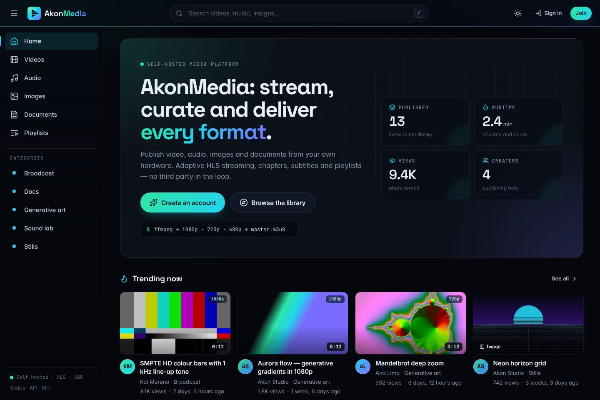
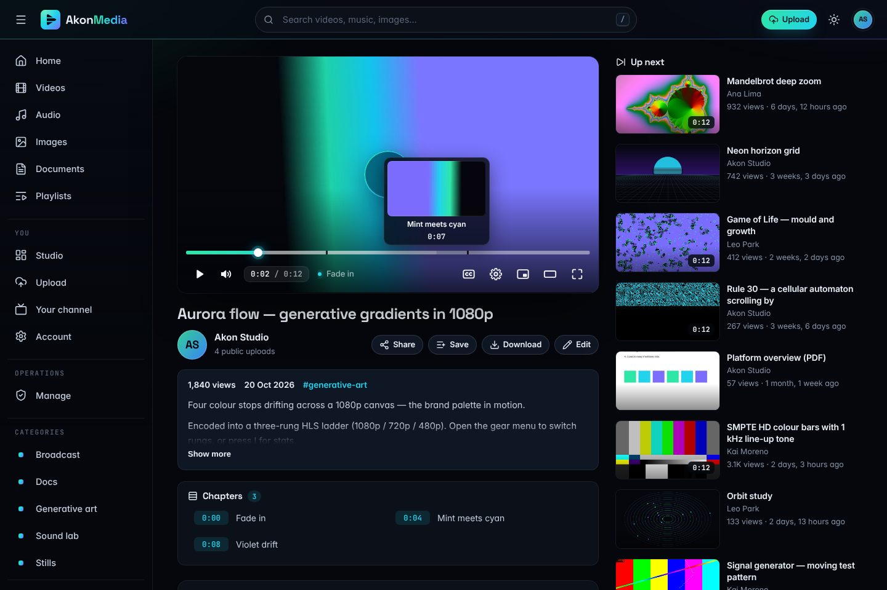
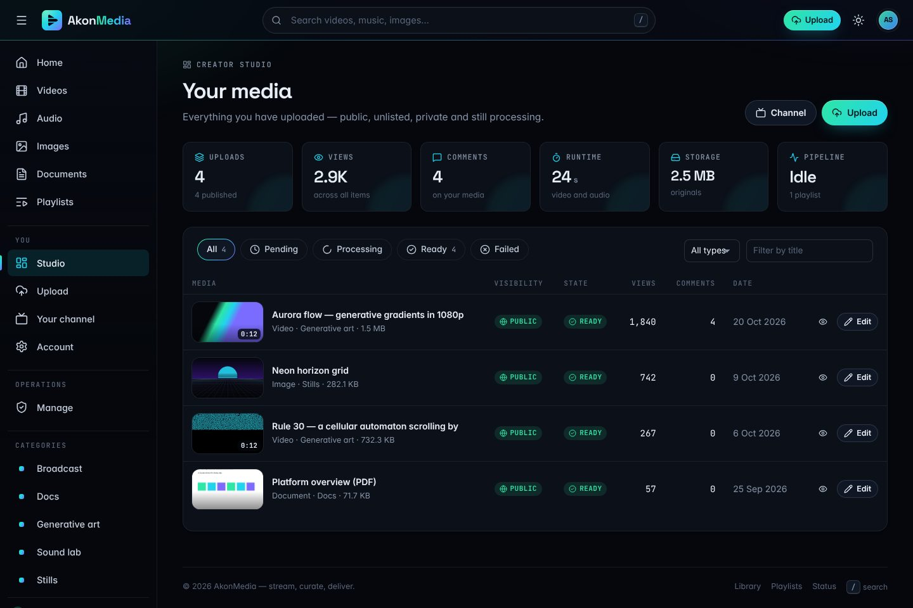
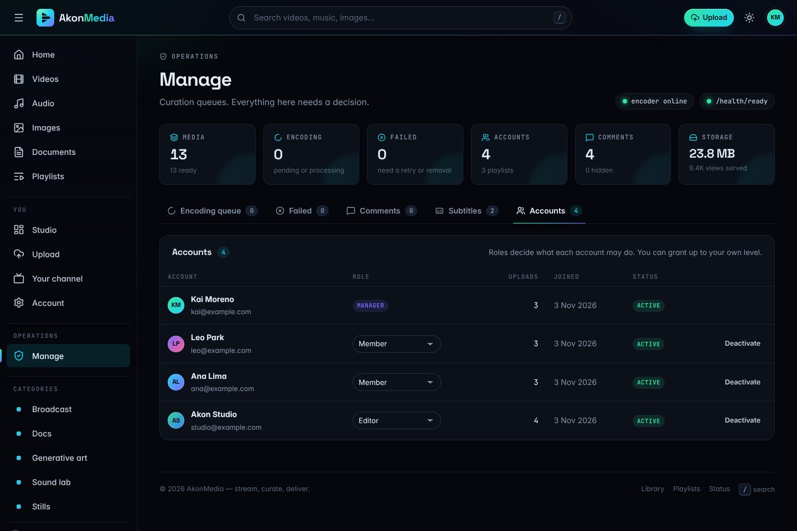
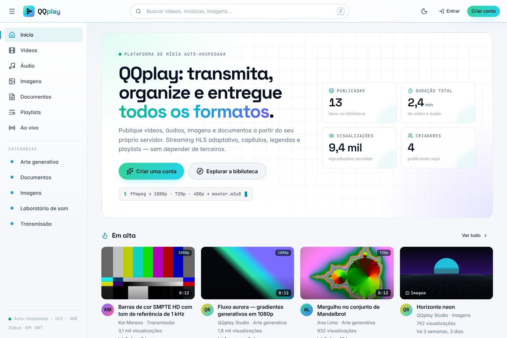
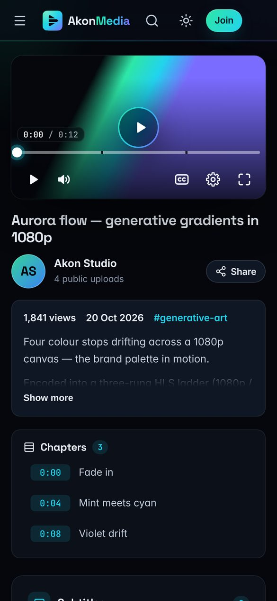

# QQplay — núcleo

O núcleo do QQplay, desenvolvido em clean room: uma plataforma de mídia
auto-hospedada construída do zero, sem nenhum código aproveitado de
implementações anteriores. O código da aplicação é trabalho original sob a
licença MIT (veja `LICENSE`); os recursos de terceiros estão listados em
[Licenças](#licenças).



| | |
|---|---|
|  |  |
|  |  |

<p align="center"></p>

## Situação

Fase 5 de 6 — a curadoria e as legendas estão prontas, e a interface foi
reconstruída de ponta a ponta. Falta a virada (cut-over) em si.

| Área | Estado |
|---|---|
| Projeto Django, configurações por ambiente, integração com o Celery | pronto |
| Contas baseadas em e-mail (cadastro, login, redefinição de senha, gestão de e-mails) via `django-allauth`, com estilo próprio | pronto |
| Escada de papéis com cinco níveis e um único módulo de política | pronto |
| Regras de visibilidade em um só módulo: pública, não listada (só com o link), privada | pronto |
| API de sessão (`/api/v1/whoami/`), verificações de liveness e readiness | pronto |
| Modelos do domínio de mídia: mídia, categoria, playlist, comentário, legenda, capítulo | pronto |
| Upload em partes retomável: novas tentativas, retomada depois de recarregar a página, cancelamento, limpeza de sessões abandonadas | pronto |
| Pipeline ffprobe/ffmpeg: pôster, escada HLS com `CODECS`, storyboard para a prévia na barra de progresso | pronto |
| Áudio: capa embutida ou um pôster com a forma de onda | pronto |
| Imagens: miniaturas que respeitam o EXIF; PDFs: prévia da primeira página (poppler) | pronto |
| API REST de mídia com regras de visibilidade e permissões por objeto | pronto |
| Biblioteca com destaque, seção "Em alta", filtros por tipo e categoria, ordenação | pronto |
| Página de vídeo: player próprio, capítulos, comentários com respostas fixados em momentos do vídeo, lista "A seguir" | pronto |
| Player: menu de qualidade, velocidade, legendas, PiP, modo teatro, painel de estatísticas, atalhos de teclado, prévias na barra de progresso | pronto |
| Playlists: criar, salvar a partir de qualquer vídeo, reordenar, compartilhar, fila "reproduzir tudo" com autoplay | pronto |
| Página de embed com opções de tempo inicial, autoplay, título e controles | pronto |
| Estúdio do criador: métricas, filtros, edição de detalhes, miniatura, capítulos, reprocessar, excluir | pronto |
| Páginas de canal e configurações da conta | pronto |
| Curadoria: fila de codificação, falhas com nova tentativa, moderação de comentários, papéis das contas | pronto |
| Upload de legendas (SRT/VTT), editor de falas sincronizado com uma prévia, download em WebVTT e SRT | pronto |
| Temas escuro e claro, layout para celular, páginas de erro com a marca | pronto |
| Interface em português do Brasil (padrão) e em inglês, com seletor de idioma | pronto |
| Lives pelo OBS ou pelo navegador: HLS, chat, embed e a gravação publicada como vídeo | pronto |
| Guia de backup e restauração | `OPERATIONS.md` |

## Requisitos

- Python 3.13
- `uv` (recomendado) ou `pip`
- ffmpeg e ffprobe para vídeo e áudio (o `pdftoppm` do poppler para prévias de PDF, opcional)

## Rodando com Docker

```bash
cp .env.docker .env     # troque SECRET_KEY e LIVE_HOOK_SECRET antes de expor na rede
docker compose up -d
docker compose exec web python manage.py createsuperuser
```

Abra <http://localhost:8000>. A primeira inicialização aplica as migrações e
coleta os arquivos estáticos; os workers esperam o banco de dados ficar pronto
em vez de disputar com ele. Os valores do `.env` sobrepõem os padrões do
`.env.docker`.

| Serviço | Função |
|---|---|
| `web` | gunicorn, serve o site e a API; healthcheck em `/health/` |
| `worker` | worker do Celery: transcodificação, miniaturas, storyboards |
| `beat` | agendador do Celery: limpeza dos uploads abandonados e manutenção das lives |
| `live` | nginx com o módulo RTMP: recebe o OBS na porta 1935 e entrega o HLS na 8080 (veja [Lives](#lives)) |
| `db` | PostgreSQL 17 |
| `redis` | cache e broker |

A imagem já traz ffmpeg e poppler, então a codificação funciona sem configuração
extra. A mídia enviada fica no volume `media`, e as lives em andamento no volume
`live`.

### Em produção

O `docker-compose.prod.yml` vai por cima do `docker-compose.yml` e transforma a
mesma stack numa instalação para a internet, numa máquina só:

- o Caddy atende nas portas 80 e 443 com certificado automático e entrega o
  portal, o HLS das lives e os arquivos de mídia (o portal só decide como cada
  arquivo sai, via `MEDIA_ACCEL_REDIRECT`);
- a codificação roda uma por vez, com prioridade menor que a das lives, e as
  tarefas rápidas ganham um worker próprio (`tasks`);
- só as portas 80, 443 e 1935 ficam abertas, e os logs são rotacionados.

O `deploy/configure.sh` escreve o `.env` de produção a partir do domínio, com
senhas geradas na hora. O passo a passo completo, numa máquina gratuita da
Oracle Cloud, está em [deploy/oracle/README.md](deploy/oracle/README.md).

## Rodando sem Docker

```bash
uv venv .venv --python 3.13
uv pip install -r requirements.txt

python manage.py migrate
python manage.py createsuperuser

python manage.py runserver
```

Sem `POSTGRES_HOST`, o projeto roda em SQLite, então não é preciso mais nada
para começar. Defina `POSTGRES_HOST` (e as variáveis relacionadas) para usar
PostgreSQL. Em desenvolvimento, o Celery executa as tarefas inline, então um
upload é codificado antes de a requisição "complete" responder.

### Conteúdo de demonstração

```bash
python manage.py seed_demo           # cerca de um minuto
python manage.py seed_demo --quick   # clipes mais curtos
```

Gera seis vídeos (1080p e 720p, para você ver a escada inteira), três áudios,
três imagens e um PDF com ffmpeg e Pillow, passa tudo pelo pipeline real e
acrescenta capítulos, legendas em inglês e em português, comentários com
respostas e três playlists. O conteúdo de demonstração é escrito em português,
como a interface padrão. O comando cria quatro contas com uma senha conhecida
(`demo-pass-123`), por isso se recusa a rodar com `DEBUG` desligado, a menos que
você passe `--force`.

## Testes

```bash
python manage.py test apps
```

Os testes do pipeline só rodam onde o ffmpeg está instalado.

### Teste de ponta a ponta no navegador

`tools/e2e/smoke.mjs` conduz um navegador de verdade pelo produto: cadastro,
upload de um vídeo em partes com uma delas derrubada de propósito, espera da
codificação, reprodução do HLS e troca de qualidade, comentário e resposta,
criação e reprodução de uma playlist, edição de detalhes, capítulos e miniatura,
inclusão e edição de legendas, estúdio, busca, temas, troca do idioma da
interface, upload e exclusão de uma imagem, embed, layouts de celular e um
gestor mudando um papel. São 42 verificações, e o teste falha diante de qualquer
erro de JavaScript. Os seletores seguem o idioma padrão da interface, o
português do Brasil.

```bash
npm i -D playwright && npx playwright install chromium   # só uma vez
python manage.py seed_demo && python manage.py runserver &
BASE_URL=http://127.0.0.1:8000 \
E2E_MANAGER_EMAIL=kai@example.com E2E_MANAGER_PASSWORD=demo-pass-123 \
node tools/e2e/smoke.mjs
```

`tools/e2e/live.mjs` testa as lives contra o servidor de ingestão de verdade,
com o ffmpeg no papel do OBS: a live é criada, a página espera com a contagem
regressiva e passa sozinha para a transmissão, espectadores e apresentador
conversam no chat, uma mensagem é ocultada, o codificador cai e volta, a live é
encerrada e a gravação vira um vídeo que o mesmo embed passa a exibir. Depois,
uma segunda live vai ao ar transmitida pelo próprio navegador, com a câmera e o
microfone falsos do Chromium. São 32 verificações; ele precisa do servidor de
ingestão rodando (veja [Lives](#lives)) e do ffmpeg.

```bash
BASE_URL=http://127.0.0.1:8000 \
E2E_HOST_EMAIL=studio@example.com E2E_VIEWER_EMAIL=ana@example.com \
E2E_PASSWORD=demo-pass-123 node tools/e2e/live.mjs
```

## Estrutura

```
config/
  settings/base.py      tudo lido do ambiente
  settings/dev.py       padrões locais permissivos
  settings/prod.py      falha de forma explícita se faltar um segredo
  formats/              formatos de data por idioma (en, pt_BR)
  urls.py               admin, contas, API, páginas públicas, favicon, robots
  context.py            valores de que todo template precisa
  celery.py             descoberta de tarefas
apps/
  core/                 páginas: biblioteca, vídeo, busca, canal, estúdio,
                        edição, playlists, legendas, gerenciar; template tags;
                        health
  rbac/                 escada de papéis e o único lugar que a interpreta
  users/                modelo de conta, admin, API de sessão
  media/                modelos, regras de acesso, API REST, pipeline ffmpeg,
                        tarefas, entrega com byte ranges, gerador da demo
  uploader/             sessões de upload em partes retomáveis e sua limpeza
  live/                 lives: chamadas do servidor de ingestão, estado, chat,
                        sala de controle, transmissão pelo navegador (relay.py)
                        e a gravação publicada como vídeo
docker/live/            servidor de ingestão das lives (nginx + módulo RTMP)
docker-compose.prod.yml a stack para a internet: Caddy com HTTPS, workers
                        ajustados para dois núcleos
deploy/                 Caddyfile, .env de produção (configure.sh), backup
                        do banco e o guia da Oracle Cloud (oracle/)
templates/              HTML escrito só para este projeto (allauth incluído)
locale/pt_BR/           catálogos em português (fontes .po e .mo compilados)
static/css/app.css      o design system: tokens, temas, layout, componentes
static/css/player.css   a aparência do player
static/js/              app.js, player.js, upload.js, live.js, cast.js
static/brand/           símbolo, logotipos, favicons, ícones de app, imagem OG
static/icons/sprite.svg sprite de ícones (Lucide, veja Licenças)
static/vendor/          builds e fontes de terceiros, com a licença ao lado
tools/build_logo.py     regenera o kit da marca, as fontes e o sprite de ícones
tools/e2e/smoke.mjs     teste de ponta a ponta no navegador
tools/e2e/live.mjs      teste de ponta a ponta das lives
```

## Notas de design

**Streaming é uma escada, não um arquivo.** Cada vídeo é codificado em até três
versões (1080/720/480 ou 720/480/360, conforme a origem) e em um `master.m3u8`
que as lista com resolução, largura de banda e os `CODECS` da RFC 6381, lidos de
volta dos segmentos codificados. A origem nunca é ampliada. O player usa hls.js
em todo lugar, exceto em aparelhos Apple, então o menu de qualidade e o painel
de estatísticas funcionam em qualquer navegador, e ele volta para o arquivo
original se o stream falhar.

**A prévia da barra de progresso é uma requisição só.** O pipeline também grava
um storyboard — uma única folha de sprites com até 100 miniaturas — e os
metadados da grade. Passar o mouse sobre a barra de progresso mostra o quadro
certo sem buscar mais nada.

**Nada na biblioteca parece quebrado.** O áudio ganha a capa embutida ou, na
falta dela, uma forma de onda desenhada nas cores da marca; as imagens ganham
uma miniatura na orientação correta; os PDFs ganham uma prévia da primeira
página. Um `.mp4` que só tem som é reclassificado como áudio. Os pôsteres são
uma conveniência: se não for possível gerar um, o item é publicado mesmo assim.

**A mídia é servida com byte ranges, com segurança.** `apps/media/serving.py`
responde `206` a requisições com `Range` (e `416` às impossíveis). Toda resposta
leva `X-Content-Type-Options: nosniff` e uma CSP de sandbox; o que não for
áudio, vídeo, imagem ou PDF é enviado como download, então um HTML ou SVG
enviado nunca consegue rodar script com os cookies do portal. Para tráfego real,
coloque nginx ou um armazenamento de objetos na frente.

**Visibilidade é dado, lido em um só lugar.** `apps/media/access.py` define quem
pode ver o quê: itens públicos aparecem nas listagens; itens não listados abrem
para quem tem o link (página, embed, legendas, detalhe na API), mas nunca
aparecem em listagens; itens privados são do dono e dos curadores. As páginas de
playlist filtram as entradas com as mesmas regras, então uma playlist pública
não vaza o vídeo privado de ninguém.

**Papéis são dados, não condicionais.** `apps/rbac/roles.py` define a escada e
`apps/rbac/permissions.py` é o único módulo que a lê. Views e templates
perguntam `can_curate_others(user)`, nunca `user.role == "editor"`. Um gestor
pode conceder papéis até o próprio nível, nunca acima dele.

**Uploads sobrevivem a redes ruins.** O navegador envia partes de 5 MB com
XMLHttpRequest (para mostrar progresso, velocidade e tempo restante reais),
tenta cada uma de novo com backoff exponencial, ressincroniza ao receber `409` e
lembra a sessão de cada arquivo, então escolher o mesmo arquivo depois de
recarregar a página continua de onde parou. Os bytes são lidos do stream bruto,
então partes de até 32 MB funcionam independentemente de
`DATA_UPLOAD_MAX_MEMORY_SIZE`. O arquivo parcial é apagado assim que o item de
mídia passa a existir, e o beat remove as sessões abandonadas há mais de
`UPLOAD_SESSION_TTL_HOURS` (ou rode `manage.py purge_uploads`).

**Excluir uma mídia libera o disco.** Remover um item remove a pasta dele —
original, pôster, escada HLS e storyboard — depois que a transação é confirmada.

**Endereços de e-mail são dados pessoais.** As páginas públicas mostram nomes de
exibição; a API só devolve o endereço de um dono ou autor à própria pessoa e aos
curadores.

**O logotipo é feito de curvas, não de texto.** `static/brand/` é gerado por
`tools/build_logo.py`, que converte a fonte Space Grotesk em curvas. O símbolo é
um botão de play cortado em três degraus — a escada de bitrates que a plataforma
codifica. O mesmo script recorta as fontes da interface só com os caracteres
usados, guarda-as no repositório e monta o sprite de ícones, então o site não
depende de nenhuma CDN para funcionar.

**O e-mail é o identificador.** Não existe coluna de nome de usuário em lugar
nenhum. Os endereços são normalizados para minúsculas ao salvar, para que uma
pessoa não consiga ter duas contas só trocando maiúsculas por minúsculas.

**As configurações falham de forma segura.** `config/settings/prod.py` gera um
erro já na importação quando falta `SECRET_KEY` ou `ALLOWED_HOSTS`, em vez de
subir em produção com um valor padrão de desenvolvimento.

## Idiomas

A interface abre em português do Brasil por padrão e também está disponível em
inglês. Todo visitante recebe o `LANGUAGE_CODE` (`pt-br`, a menos que o ambiente
defina outro); o seletor no rodapé e no menu da conta grava outra escolha no
cookie de idioma do Django. O cabeçalho `Accept-Language` do navegador é
ignorado de propósito, para que a interface nunca mude de idioma sem a pessoa
pedir.

Templates, código Python e os três scripts são todos traduzíveis: os scripts
leem os textos do catálogo JavaScript do Django (`/jsi18n/`). Números e datas
também seguem o idioma ("9,4 mil", "20 de out. de 2026"); os formatos compactos
de data ficam em `config/formats/`. Onde o próprio catálogo em português do
django-allauth deixa algo em inglês, `apps/users/translations.py` registra a
mensagem para que o catálogo do projeto possa corrigi-la. Os arquivos `.mo`
compilados ficam no repositório, então rodar o portal não exige nada a mais.
Depois de mudar ou acrescentar textos, gere os catálogos de novo (isso exige o
GNU gettext, por exemplo `apt install gettext`), traduza as entradas novas em
`locale/pt_BR/LC_MESSAGES/*.po` e compile:

```bash
python manage.py makemessages -l pt_BR --ignore=.venv --ignore="static/vendor/*"
python manage.py makemessages -d djangojs -l pt_BR --ignore=.venv --ignore="static/vendor/*"
python manage.py compilemessages -l pt_BR --ignore=.venv
```

## Lives

Transmissões ao vivo para aulas e eventos, no estilo do Vimeo: quem apresenta
transmite pelo OBS, o público assiste na página da live (ou num embed no site da
escola) com chat, e a gravação vira um vídeo da biblioteca quando a live
termina.

**Como funciona.** O serviço `live` é o nginx com o módulo RTMP
(`docker/live`). O OBS publica com a chave mostrada na sala de controle; o nginx
pergunta ao portal se a chave vale, reempacota o sinal em HLS sem recodificar
(cabe numa máquina de dois núcleos) e avisa o portal quando o sinal cai e quando
a gravação de cada conexão termina. Se o OBS cair, a live fica "interrompida"
por `LIVE_RECONNECT_GRACE_SECONDS` (dois minutos) esperando a volta; depois
disso, ou com o botão "Encerrar live", ela termina. O portal junta as gravações
e publica o resultado como um vídeo comum, que passa pelo pipeline de sempre.
O mesmo código de embed mostra a contagem regressiva, a transmissão e, no fim, a
gravação.

**No OBS.** Configurações → Transmissão, serviço Personalizado, com o servidor e
a chave da sala de controle. Em Saída: vídeo H.264 com intervalo de quadro-chave
de 2 s e áudio AAC; para 720p, de 2.500 a 4.000 Kbps. Como o servidor não
recodifica, o público recebe exatamente a qualidade que o OBS envia.

**Pelo navegador.** Na sala de controle, a aba "Por este navegador" transmite a
câmera, ou a tela com o microfone, sem instalar nada. O navegador grava o vídeo
em pedaços de um segundo e os envia ao portal; um processo do servidor
(`apps/live/relay.py`) os converte com o ffmpeg e os entrega ao serviço `live`
como se fosse o OBS, então o resto da live funciona igual. A conversão acontece
no servidor, e não no computador de quem transmite: numa máquina de dois
núcleos, conte com uma transmissão pelo navegador por vez. Exige o site em HTTPS
(ou aberto como localhost) e funciona no Chrome, no Edge e no Firefox; no Safari
não foi testado. Câmera e tela no mesmo quadro ainda pedem o OBS.

| Variável | Para quê |
|---|---|
| `LIVE_HOOK_SECRET` | segredo compartilhado entre o serviço `live` e o portal; vazio, ninguém entra no ar |
| `LIVE_RTMP_URL` | o endereço que o OBS usa, ex. `rtmp://aulas.exemplo.com.br/live` |
| `LIVE_HLS_URL` | de onde o navegador busca o HLS, ex. `https://aulas.exemplo.com.br/hls` |
| `LIVE_CONTROL_URL` | controle interno do nginx (`http://live:8081/control`), usado para encerrar uma live |
| `LIVE_RECORDINGS_DIR` | onde o portal enxerga as gravações (`/app/live/recordings` no Docker) |
| `LIVE_RECONNECT_GRACE_SECONDS` | quanto tempo esperar o OBS voltar antes de encerrar a live |
| `LIVE_RTMP_INTERNAL_URL` | para onde o portal envia as transmissões pelo navegador (`rtmp://live:1935/live` no Docker) |
| `LIVE_BROWSER_DIR` | pasta de trabalho das transmissões pelo navegador (`/app/live/browser` no Docker) |

**Em produção.** Libere a porta TCP 1935 para o OBS. Sirva o HLS (porta 8080 do
serviço `live`, caminho `/hls/`) pelo mesmo proxy HTTPS do site: com o site em
HTTPS, o navegador bloqueia um HLS em HTTP. O `docker-compose.prod.yml` já faz
as duas coisas (veja [Em produção](#em-produção)). As chamadas do nginx para o
portal chegam com o host `web`, que precisa estar em `ALLOWED_HOSTS` (o
`.env.docker` e o `deploy/configure.sh` já o incluem). Aulas longas demoram para
processar numa máquina pequena: a tarefa que publica a gravação ganha um limite
de tempo proporcional à duração.

**Sem Docker**, para desenvolver: instale o nginx com o módulo
(`apt install nginx-light libnginx-mod-rtmp`) e rode o mesmo modelo de
configuração apontando para o `runserver`, com o mesmo segredo nos dois lados.

```bash
LIVE_HOOK_SECRET=dev-secret LIVE_PORTAL_URL=http://127.0.0.1:8000 \
LIVE_DATA_DIR=$PWD/.live LIVE_NGINX_USER=$(whoami) \
LIVE_NGINX_CONF=$PWD/.live/nginx.conf LIVE_NGINX_TEMPLATE=docker/live/nginx.conf.template \
sh docker/live/entrypoint.sh
```
```bash
LIVE_HOOK_SECRET=dev-secret python manage.py runserver
```

**Limitações.** Uma qualidade só, a do OBS: converter a live em várias
qualidades em tempo real exigiria muito mais processador. A latência é a do HLS
comum, de 10 a 20 segundos, boa para aula com chat; para aula em que os alunos
abrem câmera e microfone, use uma ferramenta de videoconferência. O endereço do
HLS é aleatório e só aparece para quem pode ver a live, mas, como os arquivos de
mídia, não pede login.

## Regenerando o kit da marca

```bash
uv pip install -r requirements-dev.txt     # fonttools, brotli, cairosvg…
python tools/build_logo.py                 # ou: brand | fonts | icons
```

## Ambiente

Veja o `.env.example`. Nada é obrigatório para desenvolvimento local; em
produção são necessários, no mínimo, `SECRET_KEY`, `ALLOWED_HOSTS` e um banco de
dados. O `deploy/configure.sh` escreve um `.env` de produção completo a partir
do domínio.

## Licenças

O código da aplicação é MIT. Os arquivos de terceiros mantêm as próprias
licenças, guardadas ao lado deles em `static/vendor/` (veja
`static/vendor/README.md`): hls.js (Apache-2.0), Inter, Space Grotesk e
JetBrains Mono (SIL Open Font License 1.1) e os ícones Lucide usados para montar
`static/icons/sprite.svg` (ISC).
