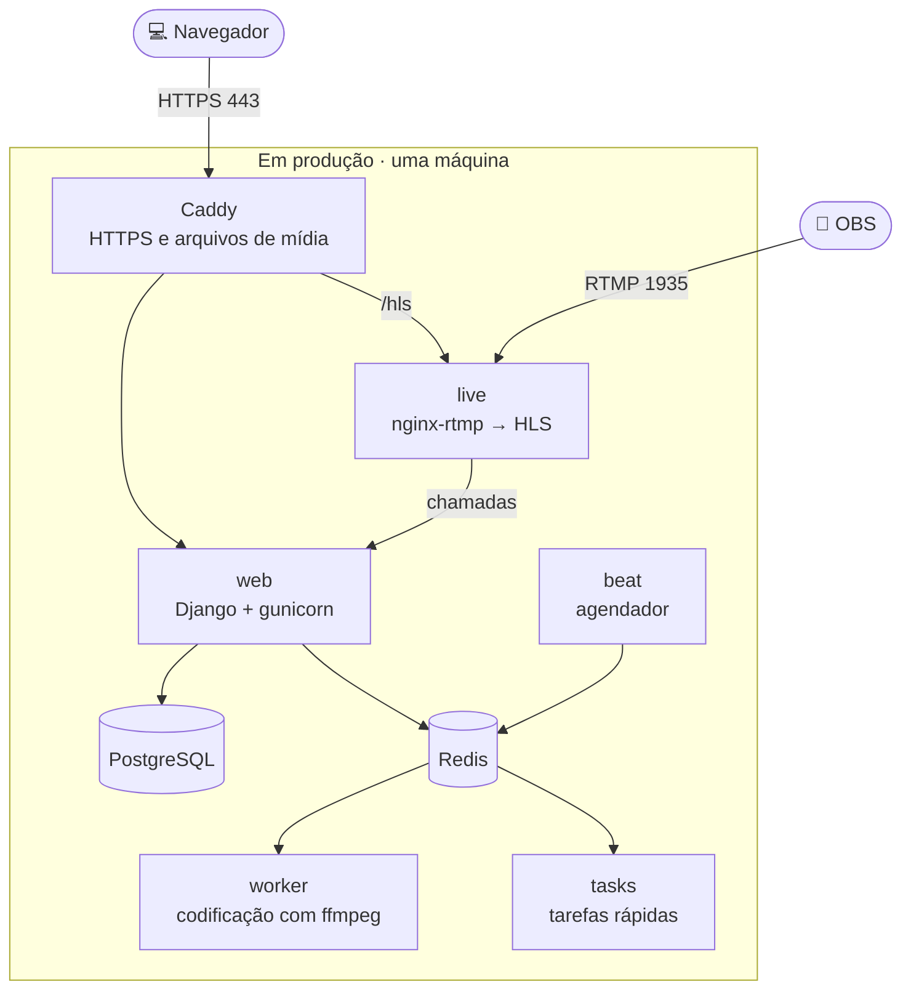
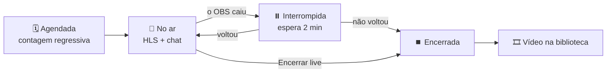

<div align="center">

<picture>
  <source media="(prefers-color-scheme: dark)" srcset="static/brand/logo-wordmark-dark.svg">
  
</picture>

### Sua plataforma de vídeo, no seu próprio servidor.

Vídeo adaptativo, lives, playlists, legendas e um estúdio para quem cria.<br>
Auto-hospedada, em português e feita do zero.

[](https://www.python.org/)
[](https://www.djangoproject.com/)
[](https://www.postgresql.org/)
[](docker-compose.yml)
[](LICENSE)
[](#idiomas)

[**Começar**](#começar) &nbsp;·&nbsp;
[**Recursos**](#recursos) &nbsp;·&nbsp;
[**Colocar no ar**](#colocar-no-ar) &nbsp;·&nbsp;
[**Lives**](#lives) &nbsp;·&nbsp;
[**Arquitetura**](#arquitetura) &nbsp;·&nbsp;
[**Desenvolvimento**](#desenvolvimento)

</div>

<br>

<picture>
  <source media="(prefers-color-scheme: light)" srcset="docs/screenshots/home-light.jpg">
  
</picture>

<br>

## Sobre

O QQplay é uma plataforma de mídia auto-hospedada, construída em clean room:
nenhum código foi aproveitado de implementações anteriores. O código da
aplicação é trabalho original sob a licença MIT (veja [`LICENSE`](LICENSE)), e
os recursos de terceiros estão listados em [Licenças](#licenças).

> [!NOTE]
> **Fase 5 de 6.** Tudo o que está em [Recursos](#recursos) está pronto: a
> curadoria e as legendas foram concluídas e a interface foi reconstruída de
> ponta a ponta. Falta a virada (cut-over) em si.

<table>
  <tr>
    <td width="33%" valign="top">
      <h3>📺 Vídeo que se adapta</h3>
      <p>Cada vídeo vira uma escada HLS de até três qualidades, com prévia na barra de progresso, capítulos e legendas.</p>
    </td>
    <td width="33%" valign="top">
      <h3>🔴 Lives sem complicação</h3>
      <p>Transmita pelo OBS ou pelo navegador, com chat e embed. Quando a live termina, a gravação vira um vídeo da biblioteca.</p>
    </td>
    <td width="33%" valign="top">
      <h3>🧩 Cabe em dois núcleos</h3>
      <p>Roda numa máquina gratuita da Oracle Cloud, com HTTPS automático, e não depende de nenhuma CDN.</p>
    </td>
  </tr>
  <tr>
    <td width="33%" valign="top">
      <h3>🎛️ Estúdio para quem cria</h3>
      <p>Métricas, edição, miniaturas, capítulos e um editor de legendas sincronizado com o vídeo.</p>
    </td>
    <td width="33%" valign="top">
      <h3>🛡️ Regras num só lugar</h3>
      <p>Cinco papéis e três níveis de visibilidade, cada um definido num único módulo e testado.</p>
    </td>
    <td width="33%" valign="top">
      <h3>🌐 Português primeiro</h3>
      <p>Interface em português do Brasil, com inglês a um clique, temas escuro e claro e layout para celular.</p>
    </td>
  </tr>
</table>

## Galeria

<table>
  <tr>
    <td width="50%">
      
      <p align="center"><sub><b>Página de vídeo</b> · player adaptativo, capítulos e prévia na barra</sub></p>
    </td>
    <td width="50%">
      
      <p align="center"><sub><b>Estúdio</b> · métricas, filtros e edição de cada mídia</sub></p>
    </td>
  </tr>
  <tr>
    <td width="50%">
      
      <p align="center"><sub><b>Gerenciar</b> · fila de codificação, estatísticas e papéis</sub></p>
    </td>
    <td width="50%">
      
      <p align="center"><sub><b>Tema claro</b> · a mesma biblioteca, com outra paleta</sub></p>
    </td>
  </tr>
</table>

<p align="center">
  <br>
  <sub><b>No celular</b> · a mesma página de vídeo, em uma coluna</sub>
</p>

## Recursos

<table>
  <tr>
    <td width="50%" valign="top">
      <h4>🎞️ Mídia e codificação</h4>
      <ul>
        <li>Pipeline ffprobe/ffmpeg: pôster, escada HLS com <code>CODECS</code> e storyboard para a prévia na barra de progresso</li>
        <li>Áudio com a capa embutida ou um pôster com a forma de onda</li>
        <li>Imagens com miniaturas que respeitam o EXIF e PDFs com prévia da primeira página (poppler)</li>
        <li>Upload em partes retomável: novas tentativas, retomada depois de recarregar a página, cancelamento e limpeza de sessões abandonadas</li>
      </ul>
    </td>
    <td width="50%" valign="top">
      <h4>▶️ Player e página de vídeo</h4>
      <ul>
        <li>Player próprio com menu de qualidade, velocidade, legendas, PiP, modo teatro, painel de estatísticas e atalhos de teclado</li>
        <li>Capítulos e prévias na barra de progresso</li>
        <li>Comentários com respostas, fixados em momentos do vídeo, e a lista "A seguir"</li>
        <li>Página de embed com tempo inicial, autoplay, título e controles</li>
      </ul>
    </td>
  </tr>
  <tr>
    <td width="50%" valign="top">
      <h4>🔴 Lives</h4>
      <ul>
        <li>Transmissão pelo OBS ou pelo navegador, entregue em HLS</li>
        <li>Chat com reações e embed</li>
        <li>A gravação publicada como vídeo quando a live termina</li>
      </ul>
    </td>
    <td width="50%" valign="top">
      <h4>📚 Biblioteca e playlists</h4>
      <ul>
        <li>Destaque, seção "Em alta", filtros por tipo e categoria e ordenação</li>
        <li>Playlists: criar, salvar a partir de qualquer vídeo, reordenar e compartilhar</li>
        <li>Fila "reproduzir tudo" com autoplay</li>
      </ul>
    </td>
  </tr>
  <tr>
    <td width="50%" valign="top">
      <h4>🎛️ Estúdio e canal</h4>
      <ul>
        <li>Estúdio do criador: métricas, filtros, edição de detalhes, miniatura, capítulos, reprocessar e excluir</li>
        <li>Legendas: upload em SRT ou VTT, editor de falas sincronizado com uma prévia e download em WebVTT e SRT</li>
        <li>Páginas de canal e configurações da conta</li>
        <li>Imagem do perfil: 16 personagens, a própria foto (enquadrada no navegador e salva sem metadados) ou as iniciais</li>
      </ul>
    </td>
    <td width="50%" valign="top">
      <h4>🛡️ Contas, papéis e curadoria</h4>
      <ul>
        <li>Contas por e-mail com <code>django-allauth</code>, em estilo próprio: cadastro, login, redefinição de senha e gestão de e-mails</li>
        <li>Escada de papéis com cinco níveis, lida por um único módulo de política</li>
        <li>Visibilidade em um só módulo: pública, não listada (só com o link) ou privada</li>
        <li>Curadoria: fila de codificação, falhas com nova tentativa, moderação de comentários e papéis das contas</li>
      </ul>
    </td>
  </tr>
  <tr>
    <td width="50%" valign="top">
      <h4>🌐 Interface</h4>
      <ul>
        <li>Temas escuro e claro e layout para celular</li>
        <li>Português do Brasil (padrão) e inglês, com seletor de idioma</li>
        <li>Páginas de erro com a marca</li>
      </ul>
    </td>
    <td width="50%" valign="top">
      <h4>🔌 API e operação</h4>
      <ul>
        <li>API REST de mídia com regras de visibilidade e permissões por objeto</li>
        <li>API de sessão (<code>/api/v1/whoami/</code>) e verificações de liveness e readiness</li>
        <li>Página de status (<code>/health/ready/</code>) e API navegável (<code>/api/v1/</code>) no navegador, com o JSON de sempre para scripts e monitores</li>
        <li>Projeto Django com configurações por ambiente e integração com o Celery</li>
        <li>Modelos do domínio de mídia: mídia, categoria, playlist, comentário, legenda e capítulo</li>
        <li>Guia de backup e restauração no <a href="OPERATIONS.md"><code>OPERATIONS.md</code></a></li>
      </ul>
    </td>
  </tr>
</table>

## Começar

### Com Docker

**Requisitos:** Docker com o plugin Compose. A imagem já traz o ffmpeg e o
poppler, então a codificação funciona sem configuração extra.

**1. Crie o `.env`.** Os valores dele sobrepõem os padrões do `.env.docker`.

```bash
cp .env.docker .env
```

> [!WARNING]
> Troque `SECRET_KEY` e `LIVE_HOOK_SECRET` no `.env` antes de expor a máquina na
> rede.

**2. Suba a stack.**

```bash
docker compose up -d
```

**3. Crie o administrador.**

```bash
docker compose exec web python manage.py createsuperuser
```

Pronto: abra <http://localhost:8000>. A primeira inicialização aplica as
migrações e coleta os arquivos estáticos, e os workers esperam o banco de dados
ficar pronto em vez de disputar com ele. A mídia enviada fica no volume `media`,
e as lives em andamento no volume `live`. Os serviços estão descritos em
[Arquitetura](#arquitetura).

### Sem Docker

**Requisitos:** Python 3.13, [`uv`](https://docs.astral.sh/uv/) (recomendado) ou
`pip`, e o ffmpeg e o ffprobe para vídeo e áudio. O `pdftoppm` do poppler, para
as prévias de PDF, é opcional.

```bash
uv venv .venv --python 3.13
uv pip install -r requirements.txt

python manage.py migrate
python manage.py createsuperuser

python manage.py runserver
```

> [!TIP]
> Sem `POSTGRES_HOST`, o projeto roda em SQLite, então não é preciso mais nada
> para começar. Defina `POSTGRES_HOST` (e as variáveis relacionadas) para usar o
> PostgreSQL. Em desenvolvimento, o Celery executa as tarefas inline: um upload é
> codificado antes de a requisição "complete" responder.

### Conteúdo de demonstração

```bash
python manage.py seed_demo           # cerca de um minuto
python manage.py seed_demo --quick   # clipes mais curtos
```

Gera seis vídeos (1080p e 720p, para você ver a escada inteira), três áudios,
três imagens e um PDF com o ffmpeg e o Pillow, passa tudo pelo pipeline real e
acrescenta capítulos, legendas em inglês e em português, comentários com
respostas e três playlists. O conteúdo é escrito em português, como a interface
padrão.

> [!CAUTION]
> O comando cria quatro contas com uma senha conhecida (`demo-pass-123`). Por
> isso ele se recusa a rodar com `DEBUG` desligado, a menos que você passe
> `--force`.

## Colocar no ar

<table>
  <tr>
    <td width="33%" valign="top">
      <h4>🐳 Docker Compose + Caddy</h4>
      <p>A stack de produção numa máquina só, com HTTPS automático.</p>
      <p><a href="docker-compose.prod.yml"><code>docker-compose.prod.yml</code></a></p>
    </td>
    <td width="33%" valign="top">
      <h4>☁️ Oracle Cloud, de graça</h4>
      <p>O passo a passo numa máquina Always Free de 2 núcleos e 12 GB.</p>
      <p><a href="deploy/oracle/README.md"><b>Guia da Oracle →</b></a></p>
    </td>
    <td width="33%" valign="top">
      <h4>🧩 Dokploy</h4>
      <p>A mesma stack atrás do Traefik de uma máquina que já roda o Dokploy.</p>
      <p><a href="deploy/dokploy/README.md"><b>Guia do Dokploy →</b></a></p>
    </td>
  </tr>
</table>

O `docker-compose.prod.yml` vai por cima do `docker-compose.yml` e transforma a
mesma stack numa instalação para a internet:

- **HTTPS:** o Caddy atende nas portas 80 e 443 com certificado automático e
  entrega o portal, o HLS das lives e os arquivos de mídia. O portal só decide
  como cada arquivo sai, via `MEDIA_ACCEL_REDIRECT`.
- **Dois núcleos:** a codificação roda uma por vez, com prioridade menor que a
  das lives, e as tarefas rápidas ganham um worker próprio (`tasks`).
- **Pouca superfície:** só as portas 80, 443 e 1935 ficam abertas, e os logs são
  rotacionados.

O `deploy/configure.sh` escreve o `.env` de produção a partir do domínio, com
senhas geradas na hora.

Numa máquina que já roda o [Dokploy](https://dokploy.com), o Traefik dele ocupa
as portas 80 e 443. Nesse caso, o `docker-compose.dokploy.yml` põe a mesma stack
atrás desse Traefik.

## Arquitetura



| Serviço | Função |
|---|---|
| `web` | gunicorn, serve o site e a API; healthcheck em `/health/` |
| `worker` | worker do Celery: transcodificação, miniaturas, storyboards |
| `beat` | agendador do Celery: limpeza dos uploads abandonados e manutenção das lives |
| `live` | nginx com o módulo RTMP: recebe o OBS na porta 1935 e entrega o HLS na 8080 (veja [Lives](#lives)) |
| `db` | PostgreSQL 17 |
| `redis` | cache e broker |
| `caddy` | só em produção: HTTPS automático na frente de tudo |
| `tasks` | só em produção: worker das tarefas rápidas, que nunca espera uma codificação |

### Como foi pensado

<details>
<summary><b>Streaming é uma escada, não um arquivo</b></summary>

<br>

Cada vídeo é codificado em até três versões (1080/720/480 ou 720/480/360,
conforme a origem) e em um `master.m3u8` que as lista com resolução, largura de
banda e os `CODECS` da RFC 6381, lidos de volta dos segmentos codificados. A
origem nunca é ampliada. O player usa hls.js em todo lugar, exceto em aparelhos
Apple, então o menu de qualidade e o painel de estatísticas funcionam em
qualquer navegador, e ele volta para o arquivo original se o stream falhar.

</details>

<details>
<summary><b>A escada cabe em dois núcleos</b></summary>

<br>

Um único ffmpeg lê e decodifica a origem uma vez e gera todas as versões. A
versão mais alta é a própria origem, copiada sem recodificar, quando o navegador
já consegue tocá-la (H.264 de 8 bits em 4:2:0, na altura exata, com quadro-chave
a cada 10 s no máximo e taxa que dê para assistir), como costumam ser as
gravações do OBS, do Zoom e das lives do portal. As outras usam qualidade
constante com teto (CRF 21, preset `veryfast`): aula com slides gasta muito
menos que o teto, e cena agitada recebe o teto.

Numa aula de teste em 1080p isso cortou o processamento em 56% e o disco em 47%,
com a versão de cima idêntica à origem e SSIM de 0,998 nas outras. Num vídeo
agitado, que não se qualifica para a cópia, o corte foi de 22%, com a mesma
qualidade. Os quadros-chave das versões codificadas caem a cada 6 s, nas bordas
dos segmentos, e o `master.m3u8` anuncia a banda medida nos próprios segmentos.

</details>

<details>
<summary><b>A prévia da barra de progresso é uma requisição só</b></summary>

<br>

O pipeline também grava um storyboard — uma única folha de sprites com até 100
miniaturas — e os metadados da grade. Passar o mouse sobre a barra de progresso
mostra o quadro certo sem buscar mais nada. Nos vídeos longos, as miniaturas vêm
só dos quadros-chave: numa aula de 15 minutos, um nono do processamento.

</details>

<details>
<summary><b>Nada na biblioteca parece quebrado</b></summary>

<br>

O áudio ganha a capa embutida ou, na falta dela, uma forma de onda desenhada nas
cores da marca; as imagens ganham uma miniatura na orientação correta; os PDFs
ganham uma prévia da primeira página. Um `.mp4` que só tem som é reclassificado
como áudio. Os pôsteres são uma conveniência: se não for possível gerar um, o
item é publicado mesmo assim.

</details>

<details>
<summary><b>A mídia é servida com byte ranges, com segurança</b></summary>

<br>

`apps/media/serving.py` responde `206` a requisições com `Range` (e `416` às
impossíveis). Toda resposta leva `X-Content-Type-Options: nosniff` e uma CSP de
sandbox; o que não for áudio, vídeo, imagem ou PDF é enviado como download,
então um HTML ou SVG enviado nunca consegue rodar script com os cookies do
portal. Para tráfego real, coloque nginx ou um armazenamento de objetos na
frente.

</details>

<details>
<summary><b>Visibilidade é dado, lido em um só lugar</b></summary>

<br>

`apps/media/access.py` define quem pode ver o quê: itens públicos aparecem nas
listagens; itens não listados abrem para quem tem o link (página, embed,
legendas, detalhe na API), mas nunca aparecem em listagens; itens privados são
do dono e dos curadores. As páginas de playlist filtram as entradas com as
mesmas regras, então uma playlist pública não vaza o vídeo privado de ninguém.

</details>

<details>
<summary><b>Papéis são dados, não condicionais</b></summary>

<br>

`apps/rbac/roles.py` define a escada e `apps/rbac/permissions.py` é o único
módulo que a lê. Views e templates perguntam `can_curate_others(user)`, nunca
`user.role == "editor"`. Um gestor pode conceder papéis até o próprio nível,
nunca acima dele.

</details>

<details>
<summary><b>Uploads sobrevivem a redes ruins</b></summary>

<br>

O navegador envia partes de 5 MB com XMLHttpRequest (para mostrar progresso,
velocidade e tempo restante reais), tenta cada uma de novo com backoff
exponencial, ressincroniza ao receber `409` e lembra a sessão de cada arquivo,
então escolher o mesmo arquivo depois de recarregar a página continua de onde
parou. Os bytes são lidos do stream bruto, então partes de até 32 MB funcionam
independentemente de `DATA_UPLOAD_MAX_MEMORY_SIZE`. O arquivo parcial é apagado
assim que o item de mídia passa a existir, e o beat remove as sessões
abandonadas há mais de `UPLOAD_SESSION_TTL_HOURS` (ou rode
`manage.py purge_uploads`).

</details>

<details>
<summary><b>Excluir uma mídia libera o disco</b></summary>

<br>

Remover um item remove a pasta dele — original, pôster, escada HLS e
storyboard — depois que a transação é confirmada.

</details>

<details>
<summary><b>Endereços de e-mail são dados pessoais</b></summary>

<br>

As páginas públicas mostram nomes de exibição; a API só devolve o endereço de um
dono ou autor à própria pessoa e aos curadores.

</details>

<details>
<summary><b>O e-mail é o identificador</b></summary>

<br>

Não existe coluna de nome de usuário em lugar nenhum. Os endereços são
normalizados para minúsculas ao salvar, para que uma pessoa não consiga ter duas
contas só trocando maiúsculas por minúsculas.

</details>

<details>
<summary><b>O logotipo é feito de curvas, não de texto</b></summary>

<br>

`static/brand/` é gerado por `tools/build_logo.py`, que converte a fonte Space
Grotesk em curvas. O símbolo é um botão de play cortado em três degraus — a
escada de bitrates que a plataforma codifica. O mesmo script recorta as fontes
da interface só com os caracteres usados, guarda-as no repositório e monta o
sprite de ícones, então o site não depende de nenhuma CDN para funcionar.

</details>

<details>
<summary><b>As configurações falham de forma segura</b></summary>

<br>

`config/settings/prod.py` gera um erro já na importação quando falta
`SECRET_KEY` ou `ALLOWED_HOSTS`, em vez de subir em produção com um valor padrão
de desenvolvimento.

</details>

## Lives

Transmissões ao vivo para aulas e eventos, no estilo do Vimeo: quem apresenta
transmite pelo OBS, o público assiste na página da live (ou num embed no site da
escola) com chat, e a gravação vira um vídeo da biblioteca quando a live
termina.



**Como funciona.** O serviço `live` é o nginx com o módulo RTMP
(`docker/live`). O OBS publica com a chave mostrada na sala de controle; o nginx
pergunta ao portal se a chave vale, reempacota o sinal em HLS sem recodificar
(cabe numa máquina de dois núcleos) e avisa o portal quando o sinal cai e quando
a gravação de cada conexão termina. Se o OBS cair, a live fica "interrompida"
por `LIVE_RECONNECT_GRACE_SECONDS` (dois minutos) esperando a volta; depois
disso, ou com o botão "Encerrar live", ela termina. O portal junta as gravações
e publica o resultado como um vídeo comum, que passa pelo pipeline de sempre. O
mesmo código de embed mostra a contagem regressiva, a transmissão e, no fim, a
gravação.

<table>
  <tr>
    <td width="50%" valign="top">
      <h4>🎥 Pelo OBS</h4>
      <p>Em Configurações → Transmissão, escolha o serviço Personalizado, com o servidor e a chave da sala de controle. Em Saída: vídeo H.264 com intervalo de quadro-chave de 2 s e áudio AAC; para 720p, de 2.500 a 4.000 Kbps. Como o servidor não recodifica, o público recebe exatamente a qualidade que o OBS envia.</p>
    </td>
    <td width="50%" valign="top">
      <h4>🌐 Pelo navegador</h4>
      <p>Na sala de controle, a aba "Por este navegador" transmite a câmera, ou a tela com o microfone, sem instalar nada. O navegador grava o vídeo em pedaços de um segundo e os envia ao portal; um processo do servidor (<code>apps/live/relay.py</code>) os converte com o ffmpeg e os entrega ao serviço <code>live</code> como se fosse o OBS, então o resto da live funciona igual.</p>
    </td>
  </tr>
</table>

A conversão das transmissões pelo navegador acontece no servidor, e não no
computador de quem transmite: numa máquina de dois núcleos, conte com uma
transmissão pelo navegador por vez. Ela exige o site em HTTPS (ou aberto como
localhost) e funciona no Chrome, no Edge e no Firefox; no Safari não foi
testada. Câmera e tela no mesmo quadro ainda pedem o OBS.

**Em produção.** Libere a porta TCP 1935 para o OBS. Sirva o HLS (porta 8080 do
serviço `live`, caminho `/hls/`) pelo mesmo proxy HTTPS do site: com o site em
HTTPS, o navegador bloqueia um HLS em HTTP. O `docker-compose.prod.yml` já faz
as duas coisas (veja [Colocar no ar](#colocar-no-ar)). As chamadas do nginx para
o portal chegam com o host `web`, que precisa estar em `ALLOWED_HOSTS` (o
`.env.docker` e o `deploy/configure.sh` já o incluem). Aulas longas demoram para
processar numa máquina pequena: a tarefa que publica a gravação ganha um limite
de tempo proporcional à duração.

> [!NOTE]
> **Limitações.** Uma qualidade só, a do OBS: converter a live em várias
> qualidades em tempo real exigiria muito mais processador. A latência é a do HLS
> comum, de 10 a 20 segundos, boa para aula com chat; para aula em que os alunos
> abrem câmera e microfone, use uma ferramenta de videoconferência. O endereço do
> HLS é aleatório e só aparece para quem pode ver a live, mas, como os arquivos
> de mídia, não pede login.

<details>
<summary><b>Variáveis das lives</b></summary>

<br>

| Variável | Para quê |
|---|---|
| `LIVE_HOOK_SECRET` | segredo compartilhado entre o serviço `live` e o portal; vazio, ninguém entra no ar |
| `LIVE_RTMP_URL` | o endereço que o OBS usa, ex. `rtmp://aulas.exemplo.com.br/live` |
| `LIVE_HLS_URL` | de onde o navegador busca o HLS, ex. `https://aulas.exemplo.com.br/hls` |
| `LIVE_CONTROL_URL` | controle interno do nginx (`http://live:8081/control`), usado para encerrar uma live |
| `LIVE_RECORDINGS_DIR` | onde o portal enxerga as gravações (`/app/live/recordings` no Docker) |
| `LIVE_RECONNECT_GRACE_SECONDS` | quanto tempo esperar o OBS voltar antes de encerrar a live |
| `LIVE_RTMP_INTERNAL_URL` | para onde o portal envia as transmissões pelo navegador (`rtmp://live:1935/live` no Docker) |
| `LIVE_BROWSER_DIR` | pasta de trabalho das transmissões pelo navegador (`/app/live/browser` no Docker) |

</details>

<details>
<summary><b>Lives sem Docker, para desenvolver</b></summary>

<br>

Instale o nginx com o módulo (`apt install nginx-light libnginx-mod-rtmp`) e
rode o mesmo modelo de configuração apontando para o `runserver`, com o mesmo
segredo nos dois lados:

```bash
LIVE_HOOK_SECRET=dev-secret LIVE_PORTAL_URL=http://127.0.0.1:8000 \
LIVE_DATA_DIR=$PWD/.live LIVE_NGINX_USER=$(whoami) \
LIVE_NGINX_CONF=$PWD/.live/nginx.conf LIVE_NGINX_TEMPLATE=docker/live/nginx.conf.template \
sh docker/live/entrypoint.sh
```

```bash
LIVE_HOOK_SECRET=dev-secret python manage.py runserver
```

</details>

## Desenvolvimento

### Testes

```bash
python manage.py test apps
```

Os testes do pipeline só rodam onde o ffmpeg está instalado.

<details>
<summary><b>Teste de ponta a ponta no navegador</b> · 46 verificações</summary>

<br>

`tools/e2e/smoke.mjs` conduz um navegador de verdade pelo produto: cadastro,
upload de um vídeo em partes com uma delas derrubada de propósito, espera da
codificação, reprodução do HLS e troca de qualidade, comentário e resposta,
criação e reprodução de uma playlist, edição de detalhes, capítulos e miniatura,
inclusão e edição de legendas, estúdio, busca, temas, troca do idioma da
interface, upload e exclusão de uma imagem (com a confirmação cancelada e depois
aceita na janela do próprio portal), embed, layouts de celular e um gestor
mudando um papel. O teste falha diante de qualquer erro de JavaScript ou janela
de confirmação do navegador. Os seletores seguem o idioma padrão da interface, o
português do Brasil.

```bash
npm i -D playwright && npx playwright install chromium   # só uma vez
python manage.py seed_demo && python manage.py runserver &
BASE_URL=http://127.0.0.1:8000 \
E2E_MANAGER_EMAIL=kai@example.com E2E_MANAGER_PASSWORD=demo-pass-123 \
node tools/e2e/smoke.mjs
```

</details>

<details>
<summary><b>Teste de ponta a ponta das lives</b> · 35 verificações</summary>

<br>

`tools/e2e/live.mjs` testa as lives contra o servidor de ingestão de verdade,
com o ffmpeg no papel do OBS: a live é criada com o horário escolhido no
calendário do portal, a página espera com a contagem regressiva e passa sozinha
para a transmissão, espectadores e apresentador conversam no chat, uma mensagem
é ocultada, o codificador cai e volta, a live é encerrada e a gravação vira um
vídeo que o mesmo embed passa a exibir. Depois, uma segunda live vai ao ar
transmitida pelo próprio navegador, com a câmera e o microfone falsos do
Chromium. Ele precisa do servidor de ingestão rodando (veja [Lives](#lives)) e
do ffmpeg.

```bash
BASE_URL=http://127.0.0.1:8000 \
E2E_HOST_EMAIL=studio@example.com E2E_VIEWER_EMAIL=ana@example.com \
E2E_PASSWORD=demo-pass-123 node tools/e2e/live.mjs
```

</details>

### Idiomas

A interface abre em português do Brasil por padrão e também está disponível em
inglês. Todo visitante recebe o `LANGUAGE_CODE` (`pt-br`, a menos que o ambiente
defina outro); o seletor no rodapé e no menu da conta grava outra escolha no
cookie de idioma do Django. O cabeçalho `Accept-Language` do navegador é
ignorado de propósito, para que a interface nunca mude de idioma sem a pessoa
pedir.

<details>
<summary><b>Traduzindo textos novos</b></summary>

<br>

Templates, código Python e os três scripts são todos traduzíveis: os scripts
leem os textos do catálogo JavaScript do Django (`/jsi18n/`). Números e datas
também seguem o idioma ("9,4 mil", "20 de out. de 2026"); os formatos compactos
de data ficam em `config/formats/`. Onde o próprio catálogo em português do
django-allauth deixa algo em inglês, `apps/users/translations.py` registra a
mensagem para que o catálogo do projeto possa corrigi-la. Os arquivos `.mo`
compilados ficam no repositório, então rodar o portal não exige nada a mais.

Depois de mudar ou acrescentar textos, gere os catálogos de novo (isso exige o
GNU gettext, por exemplo `apt install gettext`), traduza as entradas novas em
`locale/pt_BR/LC_MESSAGES/*.po` e compile:

```bash
python manage.py makemessages -l pt_BR --ignore=.venv --ignore="static/vendor/*"
python manage.py makemessages -d djangojs -l pt_BR --ignore=.venv --ignore="static/vendor/*"
python manage.py compilemessages -l pt_BR --ignore=.venv
```

</details>

### Kit da marca

```bash
uv pip install -r requirements-dev.txt     # fonttools, brotli, cairosvg…
python tools/build_logo.py                 # ou: brand | fonts | icons
python tools/build_avatars.py              # os personagens do perfil
```

Os personagens são desenhados em código (formas simples sobre os gradientes da
marca) e gravados em `static/avatars/<chave>.svg`. A chave é o que fica salvo na
conta de quem o escolheu: um personagem pode ser redesenhado, mas não renomeado
nem removido.

### Ambiente

Veja o [`.env.example`](.env.example). Nada é obrigatório para desenvolvimento
local; em produção são necessários, no mínimo, `SECRET_KEY`, `ALLOWED_HOSTS` e um
banco de dados. O `deploy/configure.sh` escreve um `.env` de produção completo a
partir do domínio.

### Estrutura

<details>
<summary><b>Onde fica cada coisa</b></summary>

<br>

```
config/
  settings/base.py      tudo lido do ambiente
  settings/dev.py       padrões locais permissivos
  settings/prod.py      falha de forma explícita se faltar um segredo
  formats/              formatos de data por idioma (en, pt_BR)
  urls.py               admin, contas, API, páginas públicas, favicon, robots
  context.py            valores de que todo template precisa
  celery.py             descoberta de tarefas
apps/
  core/                 páginas: biblioteca, vídeo, busca, canal, estúdio,
                        edição, playlists, legendas, gerenciar; template tags;
                        health
  rbac/                 escada de papéis e o único lugar que a interpreta
  users/                modelo de conta, imagem do perfil (avatars.py), admin,
                        API de sessão
  media/                modelos, regras de acesso, API REST, pipeline ffmpeg,
                        tarefas, entrega com byte ranges, gerador da demo
  uploader/             sessões de upload em partes retomáveis e sua limpeza
  live/                 lives: chamadas do servidor de ingestão, estado, chat,
                        sala de controle, transmissão pelo navegador (relay.py)
                        e a gravação publicada como vídeo
docker/live/            servidor de ingestão das lives (nginx + módulo RTMP)
docker-compose.prod.yml a stack para a internet: Caddy com HTTPS, workers
                        ajustados para dois núcleos
docker-compose.dokploy.yml  a mesma stack atrás do Traefik do Dokploy
deploy/                 Caddyfile, .env de produção (configure.sh), backup
                        do banco e os guias da Oracle Cloud (oracle/) e do
                        Dokploy (dokploy/)
templates/              HTML escrito só para este projeto (allauth incluído)
locale/pt_BR/           catálogos em português (fontes .po e .mo compilados)
static/css/app.css      o design system: tokens, temas, layout, componentes
static/css/player.css   a aparência do player
static/js/              app.js, player.js, upload.js, live.js, cast.js, avatar.js
static/brand/           símbolo, logotipos, favicons, ícones de app, imagem OG
static/avatars/         os personagens que se pode escolher para o perfil
static/icons/sprite.svg sprite de ícones (Lucide, veja Licenças)
static/vendor/          builds e fontes de terceiros, com a licença ao lado
tools/build_logo.py     regenera o kit da marca, as fontes e o sprite de ícones
tools/build_avatars.py  regenera os personagens do perfil
tools/e2e/smoke.mjs     teste de ponta a ponta no navegador
tools/e2e/live.mjs      teste de ponta a ponta das lives
```

</details>

## Licenças

O código da aplicação é **MIT**. Os arquivos de terceiros mantêm as próprias
licenças, guardadas ao lado deles em `static/vendor/` (veja
[`static/vendor/README.md`](static/vendor/README.md)):

| Componente | Licença |
|---|---|
| [hls.js](https://github.com/video-dev/hls.js) | Apache-2.0 |
| Inter, Space Grotesk e JetBrains Mono | SIL Open Font License 1.1 |
| Ícones [Lucide](https://lucide.dev), usados para montar `static/icons/sprite.svg` | ISC |

<br>

<div align="center">
  <br>
  <sub>Feito do zero, para rodar no seu próprio servidor.</sub>
</div>
